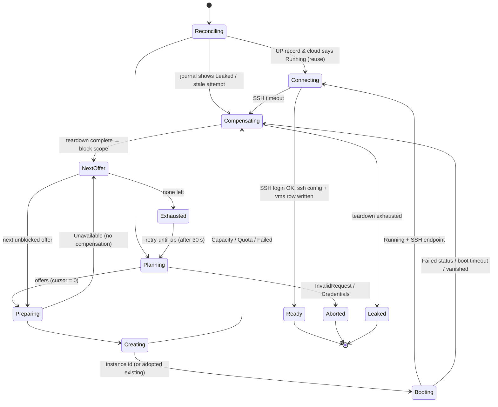
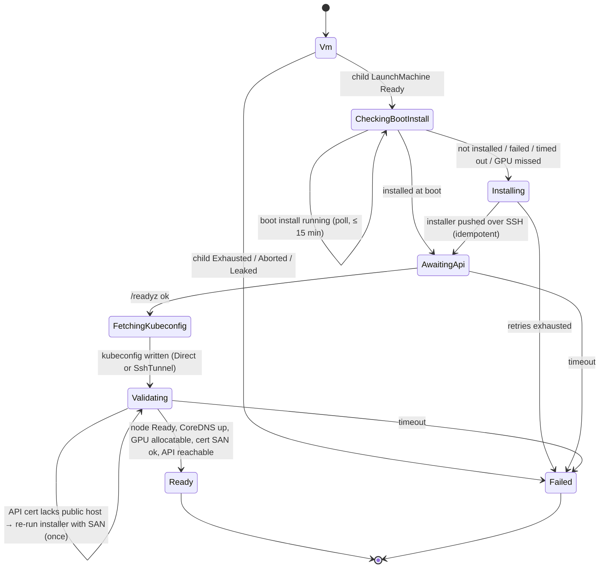

# Provisioning State Machines — Design

**Status:** implemented. This page describes the code in `src/machine/`, `src/vm/`, `src/cluster/`, and `src/provider/`. Section 1 records the review of the previous design that motivated it.
**Scope:** the VM lifecycle state machine (launch, teardown), the k3s cluster state machine layered on it, and the provider contract that every cloud adapter implements (AWS, GCP, Massed Compute, Hyperstack, Lambda, Verda, Prime Intellect, RunPod, and the Docker test cloud).

---

## 1. Review of the previous design

The previous pipeline (`orchestrator.rs` → `failover.rs` → `CloudProvider`) was a readable
plan → provision-with-failover → wait-for-SSH sequence with a sound error taxonomy. Its
weaknesses showed up as soon as a second, differently-shaped cloud (Prime Intellect) was
attempted:

| # | Problem | Where | Consequence |
|---|---------|-------|-------------|
| 1 | **The state machine is implicit.** The DB stored `PROVISIONING/UP/FAILED/TERMINATED`; the real stages (plan, bootstrap, create, wait-running, wait-ssh, persist, k3s) existed only as control flow. | `orchestrator::launch`, `failover::provision_with_failover` | A crash or Ctrl-C mid-launch lost the failover cursor and any created instance id. Recovery depended on name-tag find-or-create in the *one* region still on the row. |
| 2 | **Leak paths.** `TeardownFailed` marked the row `FAILED` and moved on. `FAILED`/`PROVISIONING` rows were never reconciled. A fatal error (e.g. credentials) after create aborted with no teardown. | `failover.rs`, `orchestrator.rs:76` | Billing resources could outlive every record pointing at them. |
| 3 | **Coarse, loop-heavy provider trait.** `provision` = bootstrap + find-or-create; `wait_running` polled for up to 10 minutes *inside* the adapter, and the engine retried it 3× (up to 30 min). Retry/backoff/polling was re-implemented per adapter. | `provider/aws/instance.rs:34`, `failover.rs:24` | Every new cloud re-wrote the robustness logic, which is where bugs hide. |
| 4 | **AWS-shaped assumptions above the trait.** The SSH endpoint was `public_ip:22` with a client-chosen user; the key travelled by cloud-init; ports, AMI and spot were assumed. | `orchestrator::finalize`, `ssh/config_file.rs` | Marketplace clouds (Prime Intellect: provider-chosen user and NAT port, keys registered via API, no firewall API) did not fit. |
| 5 | **Blocklist scope fixed at (type, region).** | `failover.rs:139` | Quota errors (region-wide) retried every type. Marketplace offers (one per data center) were over-blocked. |
| 6 | **k3s lived in `main.rs`, outside any state.** `finalize_kubernetes` ran after the VM was marked `UP`. The installer travelled by cloud-init and readiness was `kubectl get nodes` *on the node*. | `main.rs:194`, `kube.rs` | A failed k3s install left an `UP` VM with no record of it. k3s only worked on clouds with cloud-init and inbound ports. A closed port 6443 was not caught. |

## 2. Goals

1. **One shared, failure-tolerant core.** Retries, backoff, polling, deadlines, cancellation, crash-resume and compensation (teardown) are written once.
2. **Thin, uniform cloud adapters.** An adapter exposes small, idempotent primitives and classifies its errors; it contains no loops or sleeps beyond a single API call's own pagination.
3. **No silent leaks.** Every state that may own a cloud resource knows *where* it is. A failed teardown is a persistent `Leaked` state that the next command must resolve.
4. **Composable machines.** The k3s machine embeds the VM machine as a child and adds its own durable steps.
5. Stay true to the PRD wedge: a single binary with local SQLite state and no server.

## 3. Alternatives considered

| Decision | Options | Choice and rationale |
|---|---|---|
| Execution model | (a) implicit control flow (status quo) · (b) edge-triggered workflow of explicit persisted states · (c) level-triggered reconciler (Kubernetes-controller style: desired vs observed, loop until converged) · (d) external durable-execution engine (Temporal) | **(b) with (c) inside each step.** Failover is an ordered search with a cursor, which is naturally a workflow. But each step is written as *observe → act if needed → observe* (e.g. `Creating` first looks for an existing instance before calling create), so re-running any step after a crash is safe. (d) violates the single-binary constraint. |
| State encoding | Rust typestate · hand-rolled `enum` + `step()` · FSM crate (`statig`, `rust-fsm`) | **`enum` + `step()`.** Typestate cannot be serialized and resumed after a crash. A crate adds a dependency but still needs custom persistence. Serde enums give persistence for free. |
| Provider granularity | Coarse (`provision`, `wait`) · fine primitives (`plan / prepare / create / observe / delete / cleanup`) | **Fine primitives.** Coarse calls let an adapter optimise, but they duplicate polling and retry and hide progress from the journal. Fine primitives move all waiting into the core. |
| Passing offer details from plan to launch | Encode in the instance-type string (e.g. `provider__gpu__cpu__mem`) · adapter-side cache · **opaque `detail` JSON on the `Offer`, persisted** | Persisted JSON survives crashes, keeps the core cloud-agnostic, and avoids string parsing. |
| Transient-error retries | Per adapter · **central (core)** | One retry policy and one budget. Adapters return `ErrorKind::Transient`. SDK-internal retries for *reads* stay, since they are cheap and safe. |
| k3s installer delivery | cloud-init at boot only · SSH push after `Ready` only · **boot first, verified over SSH, SSH push as fallback** | Boot delivery overlaps the install with the SSH wait (about 1–2 minutes faster) but is unobservable and exists only on cloud-init clouds. SSH push works everywhere and is retryable, but is serial. The hybrid gets both: `CheckingBootInstall` reads the installer's status marker and pushes over SSH only when the boot route is missing (no cloud-init, reused VM), failed, or ran too long. A host-wide lock and an idempotent installer make the two routes safe to overlap. |
| k3s by default | opt-in `--k8s` · **on by default, opt out with `--no-k8s` / `[defaults] kubernetes = false`** | Every VM is a ready cluster. The default is skipped, with a note, on clouds that cannot host k3s (`Feature::Kubernetes` unsupported, e.g. Docker); an explicit `--k8s` there is rejected up front. |
| k3s API access | Always public `:6443` · **`Direct` when the cloud can open ports, else `SshTunnel`** | Makes k3s portable to clouds without a firewall API. Validation checks the access path the user will actually use. |
| Projection vs source of truth | One table · **`machines` (journal, source of truth) + `vms` (user-facing projection)** | The generic executor must not know VM columns. `vms` is updated idempotently by steps and can always be recomputed. |

## 4. Architecture

```
main.rs ─ CLI: provision / down / status / ssh / kubeconfig / tunnel / list
  cluster/k3s.rs      K3sMachine     = Vm(child LaunchMachine) → Install → ApiReady → Kubeconfig → Validate
  vm/launch.rs        LaunchMachine  = Reconcile → Plan → [Prepare → Create → Boot → Connect]* → Ready
  vm/teardown.rs      TeardownMachine= Request → AwaitGone → Cleanup → Done   (also the compensation sub-machine)
    machine/          Executor<M: Machine>: persist · retry budget · backoff · poll · deadline · cancel · resume
                      Journal (SQLite `machines` + `machine_events`)
      provider/mod.rs CloudProvider: capabilities · plan · prepare · create · observe · delete · cleanup
        provider/{aws, gcp, massedcompute, hyperstack, lambda, digitalocean, verda, primeintellect, runpod, docker}/   — the only code that talks to a cloud API
```

### 4.1 The provider contract (`provider/mod.rs`)

```rust
#[async_trait]
pub trait CloudProvider: Send + Sync {
    fn name(&self) -> &'static str;
    fn capabilities(&self) -> Capabilities;                       // unsupported features, boot timeout, poll interval
    async fn plan(&self, req: &ResourceRequest) -> Result<Vec<Offer>, ProviderError>;
    async fn prepare(&self, offer: &Offer, spec: &InstanceSpec) -> Result<serde_json::Value, ProviderError>;
    async fn create(&self, offer: &Offer, prepared: &serde_json::Value, spec: &InstanceSpec)
        -> Result<String /* instance id */, ProviderError>;
    async fn observe(&self, at: &Location, vm_name: &str) -> Result<Vec<Observed>, ProviderError>;
    async fn delete(&self, at: &Location, vm_name: &str, instance_ids: &[String]) -> Result<(), ProviderError>;
    async fn cleanup(&self, at: &Location, vm_name: &str) -> Result<(), ProviderError>;
}
```

Semantics every adapter must honour. These are checked by the shared conformance tests and the fake-provider tests.

| Primitive | Contract |
|---|---|
| `plan` | Ordered offers (preference = order). Pure catalog/availability lookup that creates nothing. Unplannable ask → `InvalidRequest`. |
| `prepare` | Idempotent per-(VM, location) prerequisites (security group, firewall rule, SSH-key registration, image resolution). Returns driver-private JSON, persisted. |
| `create` | **One** creation attempt. Every resource is labelled with the VM identity (`gpuprov-vm-name=<name>` tag or label, or the `gpuprov-<name>` name). No waiting for running. |
| `observe` | All non-terminated instances carrying the identity at that location, with **normalised** status and the SSH endpoint once known. |
| `delete` | Request deletion of the given instances. Idempotent: an unknown or already-deleted instance is success. Does not wait. |
| `cleanup` | Delete per-VM side resources after instances are gone. Idempotent. |
| `diagnose` (optional) | Vendor-side health for `gpuprov health`: the instance as the vendor sees it (`None` = gone) plus vendor-native findings. The default derives it from `observe`. Read-only. |

Normalised status: `Pending | Running | Stopping | Stopped | Terminating | Failed(reason)`. The core treats an instance as *booted* when it is `Running` **and** reports an `SshEndpoint { host, port, user? }`. That covers the AWS public-IP lag and Prime Intellect's late `sshConnection`.

`ProviderError { kind, msg, block }` drives the core:

| `ErrorKind` | Core action | Default block scope |
|---|---|---|
| `Transient` | retry the same step with backoff (budgeted) | — |
| `Capacity` | compensate → block → next offer | the offer |
| `Quota` | compensate → block → next offer | the whole region (all types) |
| `Unavailable` | block → next offer, **no** compensation (nothing created) | the offer |
| `Failed` | compensate → block → next offer | the offer |
| `InvalidRequest`, `Credentials` | compensate if something may exist → `Aborted` | — |

An adapter may override the scope through `block` (for example AWS `Unsupported` → instance type in region).

### 4.2 The executor (`machine/`)

```rust
#[async_trait]
pub trait Machine: Send + Sync {
    type State: Serialize + DeserializeOwned + Clone + Debug + Send + Sync;
    const KIND: &'static str;
    fn is_terminal(&self, s: &Self::State) -> bool;
    fn label(&self, s: &Self::State) -> String;                       // journal / progress line
    async fn step(&self, s: &Self::State, cx: &StepCx) -> Step<Self::State>;
    fn retry_policy(&self, s: &Self::State) -> RetryPolicy { RetryPolicy::default() }
    fn on_retries_exhausted(&self, s: &Self::State, last_error: String) -> Self::State;
    fn on_cancel(&self, s: &Self::State) -> Option<Self::State> { None }
}

pub enum Step<S> {
    Next(S),                                   // transition, persisted before the next step runs
    Poll { after: Duration, note: String },   // not done yet: same state, no budget consumed
    Retry { error: String },                  // transient: same state, backoff, budget consumed
}
```

Executor invariants:

1. **Write-ahead.** A transition is journalled before the next step's side effect. Steps that produce a handle (for example `Creating` → `Booting { instance_id }`) return it in the next state, so it is durable before any wait begins.
2. **Idempotent steps.** Because a crash can happen after a side effect but before its transition is journalled, each step tolerates re-execution (observe first).
3. **Budgets.** Consecutive `Retry`s in one state are capped (`RetryPolicy { max_attempts, initial_backoff, max_backoff }`). On exhaustion the machine names the failure state; the executor never invents one. `Poll` deadlines are enforced *by the machine* using `cx.in_state` (time since entering the state in this process), so a resume gets a fresh but bounded window.
4. **Cancellation at step boundaries only.** Ctrl-C never drops an in-flight cloud call (that would lose the handle). Between steps, `on_cancel` maps the state to a compensating state (for example `Booting` → `Compensating`). The machine then runs to a terminal state, and a second Ctrl-C exits immediately and leaves the journal resumable.
5. **Resume.** `Executor::run` loads the journalled state for the key. If it is non-terminal, execution continues from it; otherwise the caller supplies a fresh initial state.

### 4.3 VM launch machine (`vm/launch.rs`)



`Search { offers, cursor, blocked, history }` travels in every attempt state, so the failover cursor survives a crash. `Leaked { location, instance_ids, reason }` is terminal for this run, but the next `provision` or `down` for the name starts by compensating it, and `list`/`status` show it.

### 4.4 Teardown machine (`vm/teardown.rs`)

`Requesting → AwaitingGone → CleaningUp → Done | Leaked`. It is used standalone by `down` and embedded by the launch machine's `Compensating` state, so one teardown implementation serves both paths.

### 4.5 k3s cluster machine (`cluster/k3s.rs`)



* **Boot first, SSH as fallback.** On clouds whose capabilities report `boot_script`, `K3sMachine::new` sets the installer as the VM's `InstanceSpec::boot_script`, a structured script plus env, so k3s installs while the VM boots. Each adapter delivers it natively: AWS and GCP render it into cloud-init (`userdata::render`), and Verda creates a startup-script resource (`BootScript::to_shell`). The k3s layer never touches a cloud-specific format. The installer serializes on a host-wide `flock`, records `state=running|done|failed` in `/var/lib/gpuprov/k3s-install.status`, and owns `/etc/rancher/k3s/config.yaml` (re-rendered from a SAN list, restarting k3s only when it changes). `CheckingBootInstall` reads the marker plus `cloud-init status`, the k3s unit state, and GPU presence in one SSH round trip. A pure decision table (`kube::BootProbe::decide`) maps that to *installed*, *wait*, or *fall back to SSH*.
* **TLS SAN.** At boot the installer learns the public IP from the AWS/GCP metadata services. If that fails, `Validating` sees the API certificate doesn't cover the public host and re-runs the installer once with the SAN.
* **Composition.** `K3sState::Vm(LaunchState)` delegates `step` to the child machine and lifts its result. A child terminal `Ready(vm)` becomes `CheckingBootInstall { vm }`. One journal row per VM name holds the whole nested state.
* **Access mode.** `Direct` (the cloud opens 6443/80/443) or `SshTunnel` (`gpuprov tunnel <name>` forwards `127.0.0.1:6443`). The choice comes from provider capabilities, so k3s works on Prime Intellect.
* **Failure policy.** k3s failures leave the VM up (`Failed { vm }`) for debugging. `gpuprov down` removes it, and re-running `gpuprov provision` reuses the VM and re-enters at `CheckingBootInstall`.

## 5. Adapters

Each cloud's page under [Clouds](../clouds/index.md) has the details. This is how
each one maps onto the primitives:

| Cloud | plan | prepare | create | observe | delete / cleanup | boot script |
|---|---|---|---|---|---|---|
| AWS (EC2) | static GPU→type ladder × regions | type metadata, offering zones, AMI, default-VPC subnets, per-VM SG | `RunInstances` (fail-fast client, subnets in order) | `DescribeInstances` by tag | `TerminateInstances` / delete SG | cloud-init |
| GCP (Compute REST) | static ladder × zones that offer the type (live) | per-VM firewall rule; image family → image | `instances.insert` + wait for the zone operation | `instances.list` by label | `instances.delete` / delete firewall rule | cloud-init |
| Massed Compute | live `GET /gpu-inventory` | find-or-register SSH key; re-check capacity; pick image | `POST /instance/launch` (region `any`) | `GET /instance` by name | `POST /instance/terminate` / — | — (SSH route) |
| Hyperstack | live flavors ⨝ `/core/stocks` ⨝ `/pricebook` per region | re-check stock; find-or-create environment + key pair; pick image | `POST /core/virtual-machines` with labels, public IP, security rules | VM list by environment + exact name | `DELETE` VM / — | cloud-init |
| DigitalOcean | live `GET /v2/sizes` × regions where available | find-or-register SSH key; per-VM cloud firewall (by tag); pick the GPU image; re-check availability | `POST /v2/droplets` with tags + `user_data` | `GET /v2/droplets?tag_name=…` | `DELETE /v2/droplets/{id}` / delete firewall | cloud-init |
| Lambda | live `GET /instance-types` (capacity per region) | re-check capacity; find-or-register SSH key; per-VM firewall ruleset when ports are needed | `POST /instance-operations/launch` with tags + `user_data` | `GET /instances` by tag | `terminate` / delete ruleset | cloud-init |
| Verda (REST v1) | instance types × per-location availability (spot or on-demand) | find-or-register SSH key; startup script from the boot script; re-check stock; pick image | `POST /v1/instances` with tags, OS volume, key, startup script | `GET /v1/instances?tag=…` | `delete` incl. volumes / tagged volumes + scripts | startup script |
| Prime Intellect (REST) | live `GET /availability/gpus`, one offer per data center | find-or-register SSH key → `sshKeyId`; re-validate offer | `POST /pods` with the offer's cloudId/socket/dc + `sshKeyId` | `GET /pods` by name; `sshConnection` → user/port | `DELETE /pods/{id}` / — | — (SSH route) |
| RunPod (REST v2) | live `GET /v2/catalog/gpus?include=AVAILABILITY` per tier | merge account keys (read-only) into `PUBLIC_KEY`; re-validate stock | `POST /v2/pods` (GPU id/count, tier, data center, `22/tcp`) | `GET /v2/pods` by name; `ssh.direct` | `DELETE /v2/pods/{id}` / — | — (no k3s) |
| Docker (test cloud) | one offer, `local` | build the sshd image if missing | `docker run` sshd with `authorized_keys` | `docker ps/inspect` by label | `docker rm -f` / — | — (no k3s) |

## 6. Testing

* **Executor tests:** a toy machine checks persistence, resume after a simulated crash, retry exhaustion, and the cancellation mapping.
* **Launch-machine tests:** a scripted `FakeProvider` covers failover across offers, quota blocking a region, crash between create and journal (adopts the instance and does not create a duplicate), fatal error after create (compensates), and a failed teardown (`Leaked`, resolved by the next run).
* **Adapter tests:** pure classification and parsing tests. HTTP adapters (every cloud except AWS and Docker) run against `wiremock`.
* **Integration (`tests/docker_e2e.rs`, `#[ignore]` unless Docker is present):** the `docker` provider provisions a real sshd container through the full launch machine, runs a command over SSH, re-provisions idempotently, and tears down. Run with `cargo test --test docker_e2e -- --ignored`.
